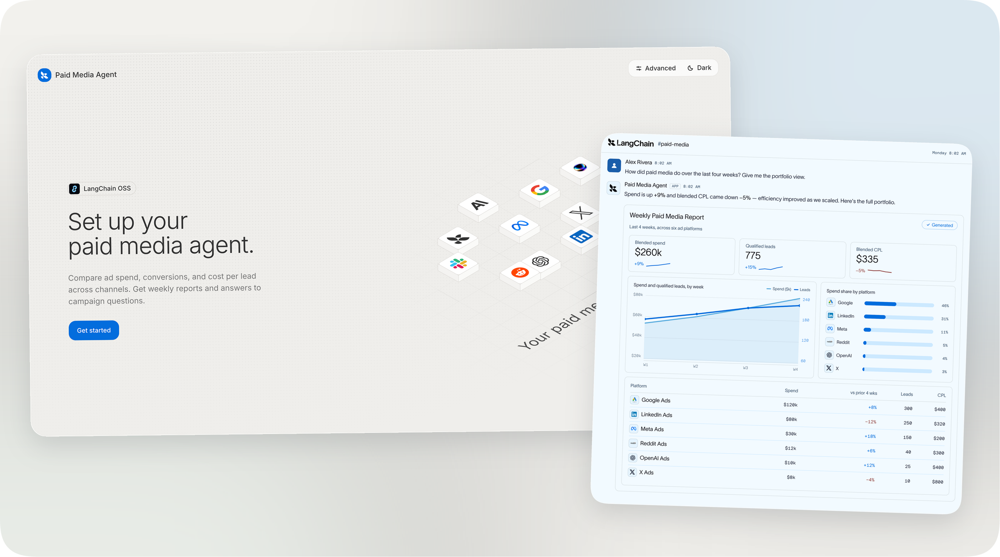

<div align="center">
  <p>
    <a href="https://www.langchain.com/?utm_source=github&utm_medium=readme&utm_campaign=paid-media-agent">
      <picture>
        <source media="(prefers-color-scheme: dark)" srcset="docs/assets/langchain-company-dark.svg">
        
      </picture>
    </a>
  </p>
  <h1>Paid Media Agent</h1>
  <p>A paid-media analyst for your team's Slack.<br>Built on <a href="https://github.com/langchain-ai/deepagents">Deep Agents</a>. Deploys with <a href="https://docs.langchain.com/langsmith/python/managed-deep-agents-overview?utm_source=github&utm_medium=readme&utm_campaign=paid-media-agent">Managed Deep Agents</a>.</p>
  <p>
    <a href="LICENSE"></a>
    <a href="https://www.python.org"></a>
    <a href="https://github.com/langchain-ai/deepagents"></a>
    <a href="docs/deploy-mda.md"></a>
  </p>
  <p>
    <b><a href="#deploy-to-your-teams-slack">Deploy to your team's Slack →</a></b> ·
    <a href="#try-it-locally">Try it locally, no keys needed</a> ·
    <a href="docs/deploy-mda.md">Deploy guide</a> ·
    <a href="OPERATIONS.md">Docs</a>
  </p>
</div>

<a href="docs/screenshots/readme-overview-light.png">
  
</a>

<p align="center">
  <sub><a href="docs/screenshots/setup-preview-light.png">Setup console</a> · <a href="docs/screenshots/report-illustration.png">Report illustration</a> with example figures.</sub>
</p>

**Ask it in Slack what changed across your ad accounts, and what to do about it.** Paid Media
Agent compares campaigns across Google, Meta, LinkedIn, TikTok, Reddit, X and more, explains the
movement with the numbers behind it, sends weekly and monthly reports, and drafts budget or status
changes for a person to approve. It deploys to your LangSmith workspace with Managed Deep Agents in
a few commands.

**Live ad account changes are off by default.** Turning them on takes a reviewed write policy,
[release checks](docs/operations/live-write-runbook.md), and an authorized approver. An approval
covers the exact proposal reviewed; an edit needs a new one.

## Deploy to your team's Slack

This repository is a [Managed Deep Agents](https://docs.langchain.com/langsmith/python/managed-deep-agents-overview?utm_source=github&utm_medium=readme&utm_campaign=paid-media-agent)
project, so it deploys as it is. You need a LangSmith account, a model key, and a
[Pipeboard](https://pipeboard.co/pricing) token for your ad accounts (it has a free plan). In your
own terminal:

```bash
curl -fsSL https://raw.githubusercontent.com/langchain-ai/paid-media-agent/main/install.sh | bash
cd paid-media-agent
uv run paid-media-agent config set LANGSMITH_API_KEY ANTHROPIC_API_KEY PIPEBOARD_API_TOKEN
uv run paid-media-agent accounts discover --add
uv run paid-media-agent mda deploy --yes
```

- The installer gets [uv](https://docs.astral.sh/uv/) if you need it, clones the repository, and
  installs its dependencies.
- `config set` asks for each key without showing it. Use a LangSmith personal access token
  (`lsv2_pt_...`).
- `accounts discover --add` maps every ad account your Pipeboard token reaches to an alias.
- `mda deploy --yes` checks the project, then deploys it, sandbox and Slack app included.

The first deploy asks which Slack app to use and prints a link to authorize it in your workspace.
Then message the app under **Apps** in Slack, or `/invite` it to a channel and mention it. The
[deploy guide](docs/deploy-mda.md) covers each step, what ships, the LangSmith Gateway, and test
copies.

**Or ask your coding agent.** Open the repo in Claude Code, Codex or Cursor and say what you want.
[AGENTS.md](AGENTS.md) routes each request to a step-by-step [skill](.agents/skills/). It never asks
you to paste a key into the chat.

| Say | It will |
| --- | --- |
| "Deploy it to our Slack." | check the install, tell you which keys to enter, connect your accounts, and hand you the deploy command after your yes |
| "Add our business context." | draft your goals, conversions, and campaign conventions from your briefs, and ask only what's missing |
| "Make the reports match our brand." | update the report design and renderer together |
| "Connect our X Ads account." | add the direct adapter's keys and map the account |

## What it does

- **Compares campaign performance** across connected accounts: spend, conversions, cost per lead,
  return on ad spend, and budget pacing, in each account's currency.
- **Investigates changes.** It finds the campaigns behind a shift, checks the supporting data, and
  flags gaps that could change the conclusion. Missing data is never treated as zero.
- **Produces reports.** Weekly and monthly summaries run on a schedule, with charts, campaign
  tables, and recommendations, as HTML or PDF.
- **Prepares changes for review.** It drafts a budget or status change with the reason, the risk,
  and how to measure and reverse it, and waits for an authorized person to approve.
- **Works in the background.** Long multi-account pulls and full reports go to read-only helpers,
  and it answers in the same thread when they finish.
- **Comes back later.** Ask it to check how an approved change did in two days, and it schedules
  its own check-in.

## How it works

Paid Media Agent is a [Deep Agents](https://github.com/langchain-ai/deepagents) agent deployed on
Managed Deep Agents, which runs the Slack app, a sandbox per thread, schedules, background helpers,
and tracing. The model decides what to investigate; code computes every metric and checks every
report figure against the source data.

- **Slack.** Each step shows above the reply while it works ("Reading Google Ads campaign
  performance"), and the reply ends with helpers running, minutes taken, and an estimated cost.
- **Ad platforms.** [Pipeboard](https://pipeboard.co/integrations) connects Google Ads, Meta Ads,
  LinkedIn Ads, TikTok Ads, Pinterest Ads, Snap Ads, Reddit Ads, and Google Analytics; X Ads and
  OpenAI Ads use read-only direct adapters. Host code holds the credentials and account ids; the
  model sees aliases.
- **Skills and a wiki.** Analysis, reporting, and change workflows are [skills](workspace/skills/),
  and a [paid-media wiki](workspace/skills/paid-media-wiki/) covers attribution, platform
  differences, benchmarks, and budget decisions. Your business context sits beside them.
- **Background helpers and check-ins.** Helpers are async subagents with read-only tools; check-ins
  are one-time schedules on the thread.
- **Writes.** Mutations run only through a typed proposal, a persisted approval of that exact
  proposal, one attempt, and a readback.

Read the [architecture](docs/architecture/README.md), or start changing it:
[instructions.md](instructions.md) · [workspace/skills/](workspace/skills/) ·
[Customization](docs/customization.md) · [Operations](OPERATIONS.md).

## Try it locally

The demo runs a scripted analysis and a simulated budget change against synthetic accounts. It
needs no keys, calls no model, and touches no live campaign:

```bash
uv run paid-media-agent demo --with-proposal
```

With a model key in `.env`, ask a real question or render a report:

```bash
uv run paid-media-agent ask "Which campaigns had the largest increase in cost per lead last week?"
uv run paid-media-agent report --cadence weekly
```

`uv run paid-media-agent setup` opens a local console for the same setup: model, accounts, and
deployment, in your browser.

## Make it yours

| Want | Add | Guide |
| --- | --- | --- |
| Your goals, conversions, and naming | `workspace/skills/company-context/` | [`paid-media-org-onboarding` skill](.agents/skills/paid-media-org-onboarding/SKILL.md) |
| Your report style | `DESIGN.md` and the renderer tokens | [Report design](docs/customization.md#report-design) |
| Report timing and delivery | `PAID_MEDIA_REPORT_*`, or `deliver_to` in `schedules/` | [Customization](docs/customization.md#memory-and-scheduling) |
| Another model | `PAID_MEDIA_MODEL` and its key, or the LangSmith Gateway | [Models](OPERATIONS.md#models) |
| Warehouse or CRM data | a read-only tool in the shared assembly | [Optional data sources](docs/customization.md#optional-warehouses-and-dbt) |
| Live changes | a write policy and the release gates | [Live-write runbook](docs/operations/live-write-runbook.md) |

Settings live in `.env`, account aliases in `config/accounts.toml`, and company context in
`workspace/skills/company-context/`. All three are Git-ignored. Redeploy with
`uv run paid-media-agent mda deploy --yes` after a change.

## Questions

**What does it cost?** The code is free (Apache 2.0). You pay your model provider and Pipeboard
(free for 2 ad accounts). Managed Deep Agents
[hosting is paid](https://www.langchain.com/pricing?utm_source=github&utm_medium=readme&utm_campaign=paid-media-agent).
A Slack reply that did work ends with its estimated model cost.

**Can it change my campaigns by itself?** No. Live changes are off until an operator enables them,
every change needs an authorized person's approval of the exact proposal, and the kill switch
(`paid-media-agent writes kill-switch on`) stops them all.

**Which models?** Claude Opus 5.5 by default. OpenAI, Google, any OpenAI-compatible endpoint, and
the LangSmith Gateway work too; `PAID_MEDIA_MODEL_EFFORT` sets reasoning effort.

**Do I need Slack?** No. Use LangSmith Studio (`uv run mda dev`), the deployment's API, or the
terminal (`paid-media-agent ask`). Background helpers and check-ins need Managed Deep Agents.

**Can I run it on my own servers?** Yes. [Self-hosting](docs/self-hosting.md) runs the same agent
with Docker, Postgres, an HTTP API, and your own Slack app:

```bash
uv run paid-media-agent config generate PAID_MEDIA_API_TOKENS PAID_MEDIA_APPROVAL_SIGNING_KEY
docker compose up -d --build
```

---

[Apache 2.0](LICENSE) · [Changelog](CHANGELOG.md) · [Security](SECURITY.md) · [Contributing](CONTRIBUTING.md) · [Code of conduct](CODE_OF_CONDUCT.md)
